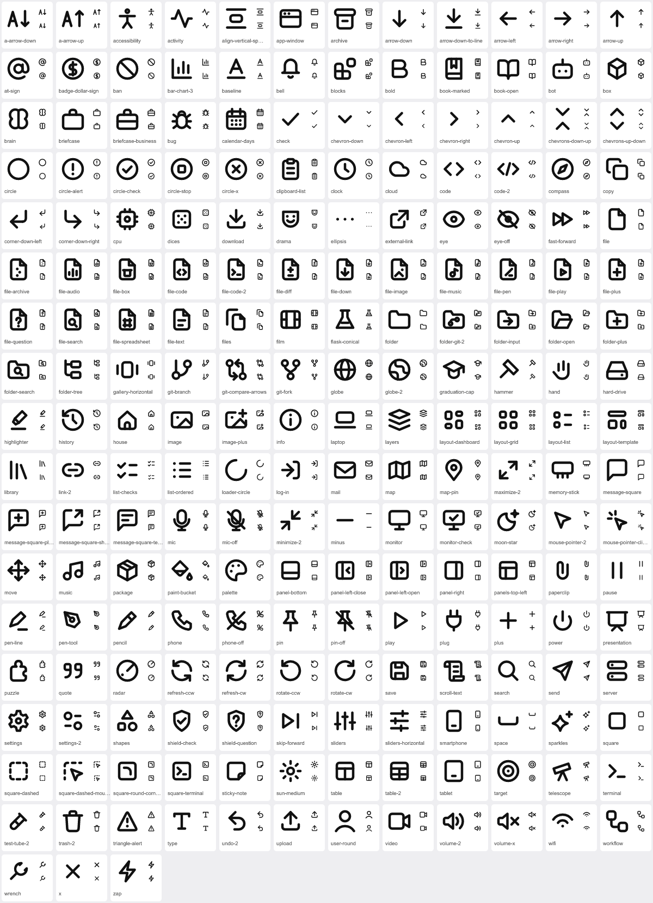
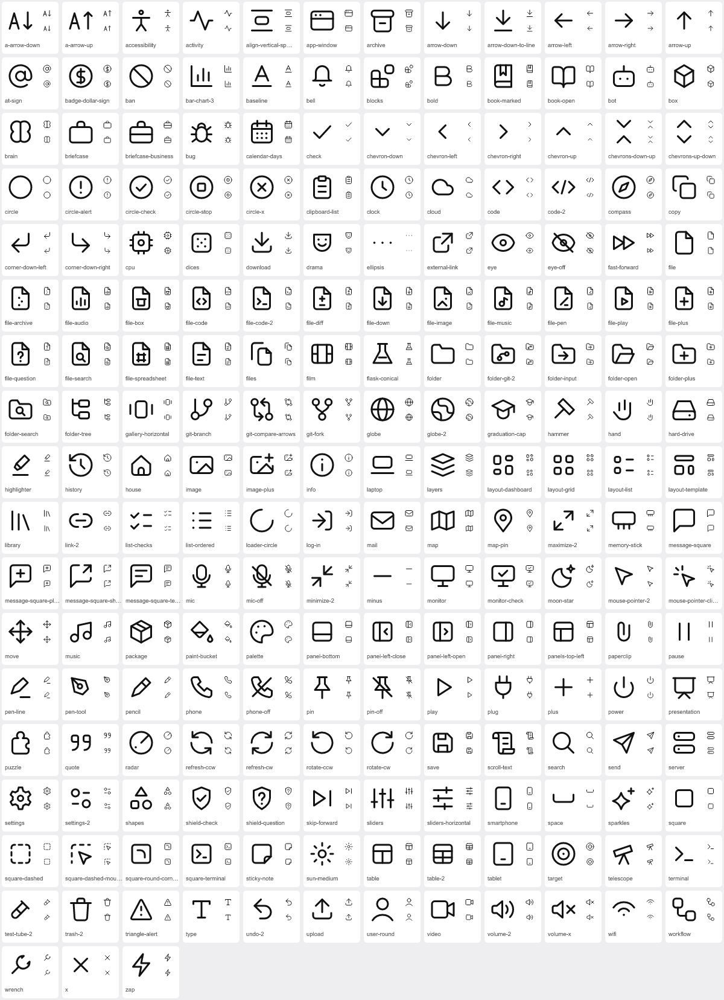

# ficon

207 icons drawn for 16px, each with its own hover animation. Plain SVG and CSS — no JavaScript, no runtime.

**[Browse the icons and docs → fabricio3g.github.io/ficon](https://fabricio3g.github.io/ficon/)**



## Why another icon set

Most icon sets are drawn on a 24px grid and scaled down. At the 14–16px sizes an interface actually uses, a 2px stroke becomes 1.33px, gaps close up, and detail turns to mush.

ficon is drawn on the grid it renders at:

- **16 × 16 grid, one stroke weight, round ends.** Regular is 1.5, bold enough to read at 14px; slim is 1.
- **One idea per icon.** Two to four strokes, rarely six. A detail that cannot keep 1.5px of clear air from its neighbour is dropped, not squeezed in.
- **Optical sizing.** Icons weigh the same; they do not measure the same. A square is drawn smaller than a circle so the two look equal.
- **Families share a skeleton.** Every `file-*` is the same page with one mark in it, every `folder-*` the same folder, every `circle-*` the same ring.

## Two weights

The same drawings come in **regular** (1.5 stroke) and **slim** (1 stroke, with smaller dots). Slim is a class, not a second set of files, so switching costs nothing:



```html
<html class="ficon-slim">            <!-- everything slim -->
<nav class="ficon-regular">…</nav>   <!-- except in here -->
<svg class="ficon ficon-check ficon-slim" …>   <!-- or one icon -->
```

For any other weight set `--ficon-stroke` (for example `--ficon-stroke: 1.25`) on the icon or an ancestor. The weight classes need `dist/ficon.css` loaded.

## Every icon moves its own way

There is no shared "wiggle". Each icon carries an animation that says what it does: the trash can lifts its lid, the check draws itself, the bell swings from its top, the download arrow drops into its tray, the eye glances sideways.

The motion is small and quick on purpose:

- plays **once**, when the button or link the icon sits in is hovered
- never longer than **300ms**, never moves more than **2px**
- only `translate`, `rotate`, `scale`, `opacity` and stroke draw-on, so it stays on the compositor
- switched off entirely under `prefers-reduced-motion`

To play an icon from code instead of on hover, put the class `ficon-play` on it or on any ancestor.

See all of them on [the site](https://fabricio3g.github.io/ficon/), or open `index.html` locally.

## Use it

### Plain HTML

Copy the markup of an icon from [`icons/`](icons) (leave out its `<style>` block), give the `<svg>` the classes `ficon ficon-<name>`, and load the stylesheet once:

```html
<link rel="stylesheet" href="dist/ficon.css" />

<button>
  <svg class="ficon ficon-trash-2" width="16" height="16" viewBox="0 0 16 16"
       fill="none" stroke="currentColor" stroke-width="1.5"
       stroke-linecap="round" stroke-linejoin="round" aria-hidden="true">
    <path class="a" d="M2.5 4.5h11M6 4.5V3a1 1 0 0 1 1-1h2a1 1 0 0 1 1 1v1.5"/>
    <path d="M4 4.5l.5 8A1.5 1.5 0 0 0 6 14h4a1.5 1.5 0 0 0 1.5-1.5l.5-8"/>
  </svg>
  Delete
</button>
```

The icon takes its colour from `currentColor` and animates when a parent `button`, `a`, `label`, `summary`, or an element with `role="menuitem" | "tab" | "option"` is hovered. Without the stylesheet the icon is simply static.

### Svelte 5

```svelte
<script lang="ts">
  import { Trash2, Check } from 'ficon';
</script>

<button><Trash2 size={16} /> Delete</button>
<Check class="size-4" weight="slim" />
```

| Prop | Default | |
|---|---|---|
| `size` | `24` | width and height in px; a sizing class wins over it |
| `weight` | inherited | `regular` (1.5) or `slim` (1); unset, it follows the nearest `.ficon-slim` / `.ficon-regular` ancestor |
| `strokeWidth` | | an exact weight on the 16px grid; wins over `weight` |
| `color` | `currentColor` | |
| `class` | | added after `ficon ficon-<name>` |

Any other attribute is passed to the `<svg>`. Icons are `aria-hidden` unless you give them an `aria-label`.

Not on npm yet — install from GitHub:

```bash
npm i github:fabricio3g/ficon
```

### As files

Each file in `icons/` is a complete SVG. Opened on its own (or used in an ``), it plays its animation once on load.

## How an icon is built

An icon is one file. The shapes come first; the `<style>` block at the end is its animation, written against the icon's own parts (`.a` … `.f`):

```svg
<svg xmlns="http://www.w3.org/2000/svg" viewBox="0 0 16 16" fill="none" stroke="currentColor" stroke-width="1.5" stroke-linecap="round" stroke-linejoin="round">
  <path class="a" d="M2.5 4.5h11M6 4.5V3a1 1 0 0 1 1-1h2a1 1 0 0 1 1 1v1.5"/>
  <path d="M4 4.5l.5 8A1.5 1.5 0 0 0 6 14h4a1.5 1.5 0 0 0 1.5-1.5l.5-8"/>
  <style>
    .a { transform-box: view-box; transform-origin: 13.5px 4.5px; animation: lid 280ms ease-out; }
    @keyframes lid { 45% { rotate: 14deg; translate: 0 -1px; } }
  </style>
</svg>
```

`npm run build` lints every file against the drawing and motion rules, then scopes each block to its icon (`.ficon-trash-2 .a`, `@keyframes ficon-trash-2-lid`) and writes:

| Output | |
|---|---|
| `dist/ficon.css` | every animation, hover-triggered and reduced-motion aware |
| `svelte/` | one component per icon and an `index.ts` barrel |
| `index.html` | the site (icons and docs), filled in from `scripts/site.html` |

```bash
npm run build   # lint, then write the outputs
npm run check   # lint only
```

The build has no dependencies; it needs Node 18 or newer.

## Contributing

The full drawing and motion rules are in [CONTRIBUTING.md](CONTRIBUTING.md). The short version: draw on the 16 grid, keep strokes 3 apart, look at it at 16px, and give it a motion that means something.

## Names

Icon names follow [Lucide](https://lucide.dev)'s naming, so ficon can stand in where Lucide names are already in use (a few older Lucide names — `AlertCircle`, `AlertTriangle`, `MoreHorizontal`, `Loader2`, `XCircle` — are exported as aliases). The drawings are ficon's own: none of Lucide's path data is used.

## License

[MIT](LICENSE)
